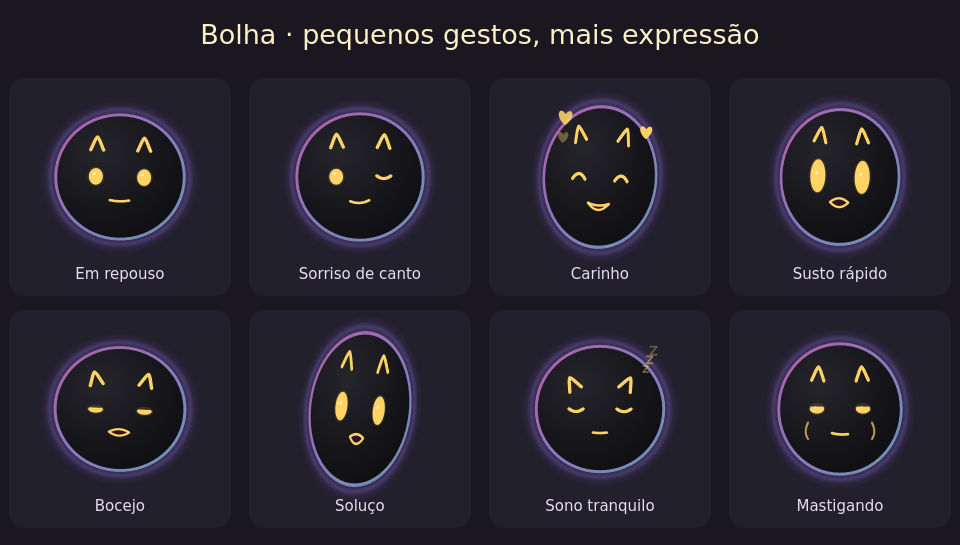

# Bolha

**Projeto open source da comunidade, baseado no Pestinha.** A Bolha é um fork
do sistema de pet virtual criado por [mille-okws](https://github.com/mille-okws)
e colaboradores. Adaptamos o cérebro, a física e a aplicação para a personagem
Bolha. Contribuições da comunidade são bem-vindas.



A Bolha passeia, pula e quica pela sua tela, brinca com um amendoim, senta no
próprio notebook e aprende com suas interações.

**Windows x64 e Android.** [Baixar no GitHub](https://github.com/kuky13/bolha/releases/latest) · [Modo flutuante e build Android](android/README.md).

[Como interagir](#como-interagir) · [Dados e contexto](#dados-e-contexto) ·
[Créditos e licenças](NOTICE.md)

A 0.5.1 acrescenta embaixadinhas com contagem e melhora a exibição de GIFs.
A série 0.5 aproxima as expressões e as atividades do Android da versão para PC,
com central de configurações, painel neural e movimento opcional ao chacoalhar.
No PC, a Bolha pode brincar de comer o ponteiro por decisão do cérebro; a opção
vem desligada. Também é possível abrir pelo código com `python main.py`, como no Pestinha.
Veja a [validação da versão](docs/VALIDATION-0.5.1.md) e a
[revisão das mudanças recentes do Pestinha](docs/PESTINHA-2026-11.md).

*Expressões da 0.5.0 renderizadas pelo Qt em Linux. A validação em Windows é
separada. A personagem Bolha
é arte própria de André Ribeiro Lima (KukySolutions), sob
[GPL-3.0-or-later](licenses/BOLHA-ASSETS.md). Notebook e bolinha usam os desenhos
Qt de Pestinha, de mille-okws e contribuidores, sob
[GPL-3.0-or-later](NOTICE.md).*


## O que acompanha

- Carinho, segurar, arrasto direto, arremessos, giro e pouso sobre janelas.
- Esfera vetorial escura com olhos dourados, orelhinhas e boca expressiva opcional. Corpo,
  olhos, orelhas e boca giram juntos; as expressões continuam dentro da esfera.
  O chão é físico e invisível.
- A boca fica fechada em repouso, no sono e durante a mastigação de brincadeira.
  Susto, alegria, bocejo, espirro e soluço têm gestos breves próprios.
- Emoções, energia, carência, aprendizado, condicionamento e memória local.
- Irritação gradual ao segurar com rubor vermelho forte, reações ao soltar, sono
  com olhos fechando, respiração e “zzz”, corações no carinho e efeitos de
  tontura e irritação que giram e se achatam junto com o corpo.
- Espreguiçada, espirro, soluço, cochilo, piscadela e movimentos de orelhas
  ocasionais. As manias cedem às interações, ao sono e aos painéis.
- Amendoim como brinquedo padrão, bolinha original opcional nas configurações,
  notebook de brincadeira, fogos, cartazes, protestos e castigo.
- Reações online de memes e GIFs (ReactionGIFs e fallback Nekos.best) carregadas
  apenas em memória conforme o que a Bolha quer expressar, além de bilhetes: no
  máximo uma travessura a cada cinco minutos, até três objetos na tela; tudo
  configurável e podendo desligar as reações online. O GIF aparece sem
  moldura, some após 15 segundos de exibição e mostra a origem no botão direito.
- Tamanhos separados para a personagem, o brinquedo, o notebook, as reações,
  os bilhetes, os cartazes, o cantinho e os efeitos.
- Bilhetes curtos aparecem perto da Bolha, um por vez, e somem sozinhos em
  5 a 8 segundos. Enquanto um bilhete está na tela, as falas aguardam.
  Os balões de fala e pensamento duram entre 3,4 e 6,2 segundos, conforme o texto.
- A Bolha pode fazer embaixadinhas quando o cérebro decide brincar com o
  brinquedo por perto. A meta de cada rodada é sorteada uniformemente de 1 a
  100; o balão mostra apenas os toques que ela acertou e some depois da rodada.
  Também dá para pedir pelo menu **Brincar → Fazer embaixadinhas**.
- Painel com os 470 neurônios, filtros, conexões reais do grupo selecionado,
  decisões recentes, humor, necessidades e associações aprendidas.
- Rotina com esquecimento gradual, objetivos persistentes e aprendizado por
  contexto. Carinho reforça preferências; ausência de resposta é neutra.
- Opções para desligar o comportamento adaptativo e apagar todo o aprendizado.
- No PC, brincadeira opcional com o ponteiro: o cérebro escolhe se aproxima,
  dá o bote e mastiga de brincadeira. Mover o mouse ou clicar restaura o cursor
  imediatamente; a Bolha reage com nojo ou tontura. O ponteiro nunca é movido ou bloqueado.

Veja [a política atual e os testes](docs/VALIDATION-0.4.0.md) e
[o histórico da implementação da inteligência](docs/INTELLIGENCE.md).
O aplicativo agora usa Qt e o cérebro no mesmo processo. O diagnóstico mede
a memória total e o tamanho dos arrays neurais separadamente; a meta do cérebro
não desliga recursos com base no consumo da interface.

## Instalação e primeiros passos

### Rodar pelo código, como no Pestinha

No Windows x64, baixe o **Source code (zip)** da página de versões ou clone o
repositório. Extraia o ZIP inteiro, abra o terminal na pasta que contém
`main.py` e execute com Python 3.11:

```powershell
python -m pip install -r requirements.txt
python main.py
```

Se o comando `python` apontar para outra versão, use `py -3.11` no lugar de
`python` nos dois comandos. Para atualizar pelo código, feche a Bolha, baixe a
versão nova e rode os comandos na pasta extraída. A Bolha usa o mesmo perfil
em `%APPDATA%\bolha`. A inicialização com o Windows exige o instalador.

### Instalador Windows

O `.exe` da página de versões já inclui Python, Qt e o cérebro.

### Como interagir

| Ação | Resultado |
|---|---|
| Pressionar e manter | Segura a Bolha; ela fica irritada aos poucos |
| Passar o mouse de um lado para o outro sobre ela | Faz carinho |
| Arrastar | Leva a Bolha ou o brinquedo junto |
| Soltar | Parado, cai; em movimento, arremessa na direção do mouse e quica |
| Rodinha | Gira |
| Menu → Interagir → Dormir um pouco | Fecha os olhos aos poucos, respira e solta “zzz” |
| Menu → Brincar → Mostrar / guardar brinquedo | Mostra ou guarda o amendoim ou a bolinha escolhida |
| Menu → Brincar → Jogar pingue-pongue | Abre uma partida com o brinquedo escolhido |
| Central da Bolha → Bolha → Brinquedo | Escolhe amendoim ou bolinha original |
| Central da Bolha → Bolha → Tamanhos e aparência | Ajusta o tamanho de cada tipo de objeto |
| Botão direito no GIF | Mostra informações, origem e opções do objeto |
| Botão direito | Abre a central e os menus de atividades |
| Central da Bolha → Testar | Prévia das expressões e simulação temporária de sinais e emoções |
| Central da Bolha → Testar → Ver o cérebro da minha Bolha | Abre o painel do cérebro da personagem |
| Central da Bolha → App → Verificar atualizações | Consulta a versão estável no GitHub |
| Ícone perto do relógio | Mostrar, esconder, pausar e sair |
| Ctrl + Alt + Shift + B | Pausa ou retoma tudo |

Soltar obedece à mesma regra na personagem e no brinquedo. Quando o sensor de
cursor está ligado, aproximar o ponteiro do amendoim ou da bolinha empurra o
brinquedo para o lado e alimenta a atenção do cérebro.

Passar o mouse de baixo para cima faz o brinquedo pular.
A Bolha corre atrás dele e o devolve quando alcança. Se você o tirar do
alcance repetidamente, ela fica brava. O brinquedo para de rolar quando repousa,
e as reações online surgem em cantos variados da área útil das telas.

Escolha **Jogar pingue-pongue** no menu da Bolha ou da
bandeja. Com a leitura do cursor ativa, passe o ponteiro pelo brinquedo para
rebater, direto no desktop. O gesto muda o ângulo da devolução. A partida
pausa fora da área útil do monitor em que começou e termina quando alguém
marca cinco pontos. Escolha **Encerrar pingue-pongue** para voltar ao passeio.

A Bolha tem pousos animados em pé, de lado e de ponta-cabeça.
Após 12 arremessos fortes em um minuto, a Bolha estoura. Trinta segundos depois,
ela espia com um olho pela borda da tela, recua e sai devagar. Carinho ajuda
a recuperar a confiança mais rápido. O limite e a opção de desligar o estouro
ficam em **Central da Bolha → Bolha → Comportamento e aprendizado**.

Ela evita monitores em tela cheia e continua nos demais; se todos estiverem
ocupados, fica escondida. Iniciar com o Windows é opcional e vem desligado.

## Dados e contexto

Tudo o que a Bolha aprende fica em `%APPDATA%\bolha\brain`. Aparência e
preferências ficam no diretório próprio `%APPDATA%\bolha`, separado de outros
aplicativos. Reinstalar ou atualizar preserva esses arquivos. A versão 0.3 faz backup verificável antes de converter preferências e preserva
a semente da rede e os formatos do aprendizado. A migração pode ser repetida
sem sobrescrever uma pasta de memória nova existente. Perfis da versão 0.1
continuam lendo e gravando na pasta original de aprendizado, para uma recuperação
da versão anterior encontrar a mesma memória; ela não é renomeada na atualização.

Você pode desligar separadamente a leitura do nome do programa ativo, do
tempo ocioso, da posição do cursor e da geometria das janelas. Não há captura
de tela, leitura de títulos/conteúdo, chat, conta, créditos ou provedor de IA.

A comunicação de rede do aplicativo limita-se à busca/download de atualizações
no GitHub e, quando a opção de reações online está ativa nas configurações, à
busca sem chave de memes/GIFs públicos (ReactionGIFs e Nekos.best) usando
somente palavras-chave genéricas de humor em inglês; os bytes de mídia ficam
apenas em memória RAM (nunca em disco), têm a animação pausada quando a janela
fica oculta. Os bytes são descartados ao terminar a exibição, guardar o GIF
ou desativar a opção. O tempo de exibição pausa durante o arrasto, quando o
ponteiro está sobre o GIF ou quando o menu dele está aberto.
O cérebro e a interface usam o mesmo processo Python, sem abrir portas locais
ou enviar sua memória, programas ativos, coordenadas ou arquivos para servidores.

## Atualizações

A versão instalada consulta o GitHub ao abrir e a cada seis horas. Uma versão
nova é baixada e verificada por tamanho e SHA-256. Depois aparece um aviso de 30 segundos, com opção
de adiar por uma hora. Ao instalar, a Bolha salva seu aprendizado, atualiza
e reabre. O instalador usado é removido depois que a nova interface e o cérebro
confirmam a inicialização; arquivos ainda bloqueados são limpos depois.
O instalador prepara os arquivos antes de substituir a versão anterior e recupera
a instalação se a nova não confirmar saúde. Arquivos desconhecidos e o backup
legado do Electron ficam preservados para recuperação; o diagnóstico local
registra o caminho quando essa cópia precisa ser mantida.

## Como funciona

O desenho e as janelas transparentes usam Python 3.11 e Qt/PySide6. O cérebro é
uma adaptação da rede neural local original do [Pestinha](https://github.com/mille-okws/pestinha),
com 470 neurônios. A origem do motor e as adaptações estão em [NOTICE.md](NOTICE.md).

## Compilar pelo código

No Windows x64, use Python 3.11. Nenhum Node.js, `.env`, credencial ou serviço
da OneDrip é necessário.

```powershell
py -3.11 -m venv .venv
.venv\Scripts\python -m pip install -r requirements-build.txt
.venv\Scripts\python main.py
.venv\Scripts\python -m pytest -q
.venv\Scripts\python scripts/build_native.py
```

O resultado fica em `release/`. O script usa PyInstaller e NSIS portátil fixado
por checksum, sem instalar o compilador globalmente. Veja
[compilação e testes Windows](docs/BUILD.md), [validação da 0.3.3](docs/VALIDATION-0.3.3.md),
[validação da pega 0.3.2](docs/VALIDATION-GRAB.md),
[histórico da 0.3.1](docs/VALIDATION-EXPRESSIONS.md)
e [histórico da migração Qt 0.3.0](docs/VALIDATION-NATIVE.md).
O pipeline da Bolha só roda manualmente ou por tag; salvar commits e abrir
PRs não dispara compilações de instalador. Tags só publicam após os testes.

## Organização

- `bolha/`: janelas Qt, desenho, preferências, diálogos e atualização.
- `brain/`: cérebro do Pestinha, física, comportamento e aprendizado.
- `assets/bolha/content/`: memes, cartazes e recados próprios.
- `packaging/`: instalador NSIS e avisos do pacote.
- `tests/native/` e `brain/tests/`: verificações automatizadas.
- `docs/`: instruções e validação; `NOTICE.md`: autoria e origem do código.

O Game é a única autoridade para física e comportamento. O notebook do pet
é uma brincadeira e não executa comandos no computador. Electron, React,
Framer Motion, IPC e o processo separado do cérebro foram retirados.

## Licenças

O código da Bolha e o código derivado do Pestinha são open source sob
**GPL-3.0-or-later**, a mesma licença do Pestinha. A comunidade pode estudar,
modificar e contribuir com o projeto, respeitando a licença e os créditos.
Consulte [LICENSE](LICENSE) e [NOTICE.md](NOTICE.md).

As artes e animações próprias da Bolha também estão sob **GPL-3.0-or-later**.
Consulte [licença das artes](licenses/BOLHA-ASSETS.md). Os memes e textos do
pacote original do Pestinha não fazem parte da distribuição da Bolha;
os arquivos originais continuam identificados pela licença e autoria indicadas
pelo Pestinha no histórico upstream deste fork.

O projeto é aberto à comunidade. As referências privadas de Drippy não estão
neste repositório e não fazem parte da licença ou dos artefatos da Bolha.
