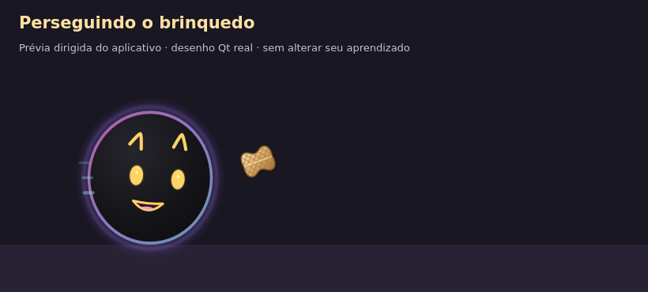

# Bolha

A Bolha é uma mascote virtual de desktop, open source e feita pela comunidade.
Ela passeia pela tela, reage a carinho e brinca com um brinquedo e um notebook.
Seu cérebro e seu aprendizado funcionam localmente.

**Windows x64 e Android.** [Baixar para Windows 0.5.9.2](https://github.com/kuky13/bolha/releases/download/v0.5.9.2/Bolha-Setup-0.5.9.2-x64.exe) ·
[Baixar APK 0.5.9.0](https://github.com/kuky13/bolha/releases/download/v0.5.9.0/Bolha-0.5.9.0-Android.apk) ·
[Notas da versão](https://github.com/kuky13/bolha/releases/latest) · [Guia Android](android/README.md)



[Ver a corrida](docs/previews/bolha-corrida.gif) ·
[Ver o notebook](docs/previews/bolha-notebook.gif)

*Cenas dirigidas do aplicativo, renderizadas em Qt no Linux.*

## Rodar pelo código

Use Python 3.11. No Windows, abra o terminal na pasta do projeto e execute:

```powershell
py -3.11 -m venv .venv
.venv\Scripts\python -m pip install -r requirements.txt
.venv\Scripts\python main.py
```

Para criar um instalador próprio, consulte [como compilar e validar](docs/BUILD.md).
Para personalizar cores, expressões, frases ou o notebook, veja o
[guia de personalização](docs/PERSONALIZAR.md) ou abra o índice de [Guias](docs/README.md).

## Interações essenciais

- Mova o ponteiro de um lado para o outro sobre a Bolha para fazer carinho; mantenha pressionado para segurá-la.
- Arraste e solte para mover; solte em movimento para arremessar.
- Use a rodinha para girar. Clique com o botão direito para abrir o menu e a Central.
- No menu **Brincar**, mostre ou guarde o brinquedo e inicie pingue-pongue. O brinquedo padrão é a bolinha. Você pode trocar pelo amendoim na Central.
- **Ctrl + Alt + Shift + B** pausa ou retoma a Bolha.

Veja o [guia de uso](docs/USO.md) para os demais gestos, menus e opções.

## Privacidade

Preferências e aprendizado ficam no dispositivo. A Bolha não captura a tela,
lê o conteúdo de janelas ou texto digitado, nem envia o perfil ou a memória a
servidores. Leituras locais opcionais podem ser desligadas separadamente.

A edição instalada consulta atualizações no GitHub. Reações online também usam
a rede quando ativadas; a busca envia palavras-chave genéricas de humor a
ReactionGIFs ou Nekos.best, e as imagens ficam em memória durante a exibição.
Você pode desligar as reações online na Central. Os detalhes estão em
[dados e rede](docs/USO.md#perfil-privacidade-e-rede).

## Integrações do Windows

Na Central, abra **App → Integrações do Windows**. Toque duas vezes no **Alt
esquerdo** para a própria Bolha seguir e mastigar o cursor até o próximo
clique. Use **Esc** para cancelar ou **Ctrl+=** para
pausar ou retomar a sessão atual de mídia. Os atalhos são configuráveis.
O Spotify para Windows pode fazer a Bolha dançar quando começa outra faixa.
O ícone de bateria perto do relógio dá acesso ao menu da Bolha e ao painel com a
carga dos periféricos compatíveis. Os conectados e acordados aparecem no topo.
A Central permite ajustar os avisos e ativar um ícone separado para a mascote.

O localizador e a dança respeitam telas cheias usando a leitura opcional
**Janelas abertas**. O controle de mídia, os metadados da música e a leitura
de bateria são locais. A leitura de bateria no pacote Windows usa o
[BatteryHub](https://github.com/krisgfx9/Wireless-Device-Battery-Monitor).
O localizador é inspirado no [Multi-Monitor-Mouse-Finder](https://github.com/inspiringsource/Multi-Monitor-Mouse-Finder).

## Código, arte e créditos

O projeto é baseado no **Pestinha**, criado por [@mille-okws e colaboradores](https://github.com/mille-okws/pestinha).
O código, as artes e as animações próprias da Bolha são licenciados sob
**GPL-3.0-or-later**. Preserve os créditos e avisos ao compartilhar mudanças.

- [Licença do código](LICENSE), [créditos e origem](NOTICE.md)
- [Licença das artes da Bolha](licenses/BOLHA-ASSETS.md)
- [Contribuir com o projeto](CONTRIBUTING.md)
- [Notas da versão](docs/RELEASE.md) e [histórico de validação](docs/VALIDATION-NATIVE.md)
- [Roadmap futuro de otimização com Rust](docs/ROADMAP-RUST.md)

O personagem Bolha e suas artes próprias são de André Ribeiro Lima
(KukySolutions). O notebook foi redesenhado a partir do notebook do Pestinha;
a bolinha adapta arte de mille-okws e colaboradores. Memes e textos originais
do Pestinha não fazem parte do pacote da Bolha. Consulte os avisos de origem
antes de redistribuir recursos.
