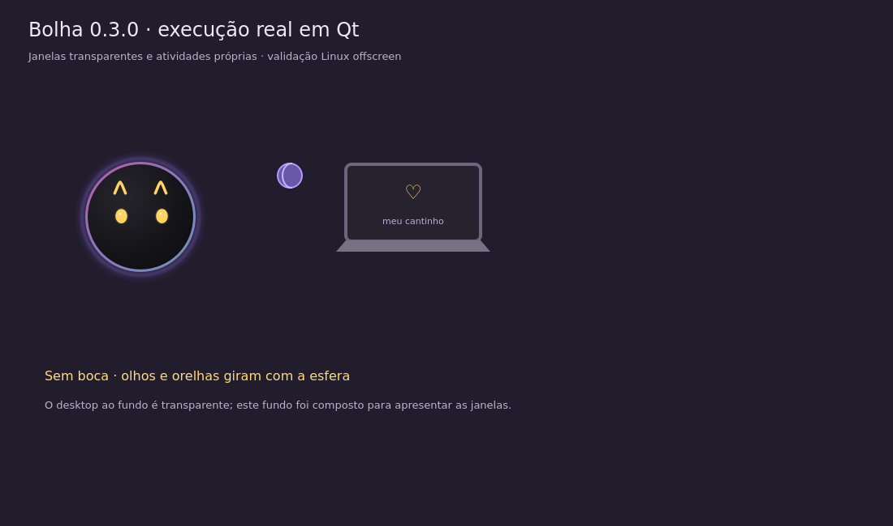

# Bolha



A Bolha passeia, pula e quica pela sua tela, brinca com um amendoim, senta no
próprio notebook e aprende com suas interações.

**Experimental · Windows x64 · Fonte 0.3.1 em validação.**

[Instalador publicado](https://github.com/kuky13/bolha/releases/latest) ·
[Como interagir](#como-interagir) · [Dados e contexto](#dados-e-contexto) ·
[Créditos](NOTICE.md)

A 0.3.1 tem instalador de teste compilado no CI Windows. A atualização real
0.3.0 → 0.3.1 e os ensaios dirigidos passaram; a revisão manual prolongada
continua pendente, sem release publicada. Resultados e limites estão em
[validação da 0.3.1](docs/VALIDATION-EXPRESSIONS.md).

*Imagem da versão 0.3.0: execução Qt capturada em Linux offscreen, com fundo
composto para apresentar janelas transparentes. A validação em Windows é separada. A personagem Bolha
é arte própria de André Ribeiro Lima (KukySolutions), sob
[CC BY-NC 4.0](licenses/BOLHA-ASSETS.md). Notebook e bolinha usam os desenhos
Qt de Pestinha, de mille-okws e contribuidores, sob
[GPL-3.0-or-later](NOTICE.md).*

## O que acompanha

- Carinho, segurar, arrasto direto, soltura por gravidade, giro e pouso sobre janelas.
- Esfera vetorial escura com olhos dourados e orelhinhas, sem boca. Corpo,
  olhos e orelhas giram juntos; as expressões continuam dentro da esfera.
  O chão é físico e invisível.
- Emoções, energia, carência, aprendizado, condicionamento e memória local.
- Irritação gradual ao segurar, reações ao soltar, sono com olhos fechando,
  respiração e “zzz”, corações no carinho e efeitos de tontura e irritação.
- Espreguiçada, espirro, soluço, cochilo, piscadela e movimentos de orelhas
  ocasionais. As manias cedem às interações, ao sono e aos painéis.
- Amendoim como brinquedo padrão, bolinha original opcional nas configurações,
  notebook de brincadeira, fogos, cartazes, protestos e castigo.
- Oito memes novos da Bolha e bilhetes: no máximo uma travessura a cada cinco
  minutos, até três objetos na tela; tudo configurável.
- Painel com atividade neural, humor, necessidades e associações aprendidas.
- Rotina com esquecimento gradual, objetivos persistentes e aprendizado por
  contexto. Carinho reforça preferências; ausência de resposta é neutra.
- Opções para desligar o comportamento adaptativo e apagar todo o aprendizado.

Veja [a implementação da inteligência e seu orçamento](docs/INTELLIGENCE.md).
O aplicativo agora usa Qt e o cérebro no mesmo processo. O diagnóstico mede
a memória total e o tamanho dos arrays neurais separadamente; a meta do cérebro
não desliga recursos com base no consumo da interface.

## Instalação e primeiros passos

Instale o `.exe` da página de versões. O instalador já inclui Python, Qt e o cérebro;
não é necessário instalar Python separadamente.

### Como interagir

| Ação | Resultado |
|---|---|
| Pressionar e manter | Segura a Bolha; ela fica irritada aos poucos |
| Passar o mouse de um lado para o outro sobre ela | Faz carinho |
| Arrastar | Leva a Bolha ou o brinquedo junto |
| Soltar | Libera a gravidade, sem impulso do mouse, mesmo após arrasto rápido |
| Rodinha | Gira |
| Menu → Dormir um pouco | Fecha os olhos aos poucos, respira e solta “zzz” |
| Menu → Brinquedo | Mostra ou guarda o amendoim ou a bolinha escolhida |
| Configurações → Comportamento → Brinquedo | Escolhe amendoim ou bolinha original |
| Botão direito | Abre configurações e atividades |
| Menu → Cérebro e emoções | Abre o painel do cérebro |
| Ícone perto do relógio | Mostrar, esconder, pausar e sair |
| Ctrl + Alt + Shift + B | Pausa ou retoma tudo |

Soltar obedece à mesma regra na personagem e no brinquedo. A proximidade do
ponteiro pode chamar a atenção do cérebro quando o sensor está ligado; as
brincadeiras são decididas pelo pet, sem chute automático do mouse.

Ela evita monitores em tela cheia e continua nos demais; se todos estiverem
ocupados, fica escondida. Iniciar com o Windows é opcional e vem desligado.

## Dados e contexto

Tudo o que a Bolha aprende fica em `%APPDATA%\bolha\brain`. Aparência e
preferências ficam no diretório próprio `%APPDATA%\bolha`, separado de outros
aplicativos. Reinstalar ou atualizar preserva esses arquivos. A versão 0.3 faz backup verificável antes de converter preferências e preserva
a semente da rede e os formatos do aprendizado. A migração pode ser repetida
sem sobrescrever uma pasta de memória nova existente. Perfis da versão 0.1
continuam lendo e gravando na pasta original de aprendizado, para uma recuperação
da versão anterior encontrar a mesma memória; ela não é renomeada na atualização.

Você pode desligar separadamente a leitura do nome do programa ativo, do
tempo ocioso, da posição do cursor e da geometria das janelas. Não há captura
de tela, leitura de títulos/conteúdo, chat, conta, créditos ou provedor de IA.

A única comunicação de rede do aplicativo é a busca/download de atualizações
no GitHub. O cérebro e a interface usam o mesmo processo Python, sem
abrir portas locais ou enviar sua memória para servidores.

## Atualizações

A versão instalada consulta o GitHub ao abrir e a cada seis horas. Uma versão
nova é baixada e verificada por tamanho e SHA-256. Depois aparece um aviso de 30 segundos, com opção
de adiar por uma hora. Ao instalar, a Bolha salva seu aprendizado, atualiza
e reabre. O instalador usado é removido depois que a nova interface e o cérebro
confirmam a inicialização; arquivos ainda bloqueados são limpos depois.
O instalador prepara os arquivos antes de substituir a versão anterior e recupera
a instalação se a nova não confirmar saúde. Arquivos desconhecidos e o backup
legado do Electron ficam preservados para recuperação; o diagnóstico local
registra o caminho quando essa cópia precisa ser mantida.

## Como funciona

O desenho e as janelas transparentes usam Python 3.11 e Qt/PySide6. O cérebro é
uma adaptação da rede neural local original do [Pestinha](https://github.com/mille-okws/pestinha),
com 470 neurônios. A origem do motor e as adaptações estão em [NOTICE.md](NOTICE.md).

## Compilar pelo código

No Windows x64, use Python 3.11. Nenhum Node.js, `.env`, credencial ou serviço
da OneDrip é necessário.

```powershell
py -3.11 -m venv .venv
.venv\Scripts\python -m pip install -r requirements-build.txt
.venv\Scripts\python -m bolha
.venv\Scripts\python -m pytest -q
.venv\Scripts\python scripts/build_native.py
```

O resultado fica em `release/`. O script usa PyInstaller e NSIS portátil fixado
por checksum, sem instalar o compilador globalmente. Veja
[compilação e testes Windows](docs/BUILD.md), [validação da 0.3.1](docs/VALIDATION-EXPRESSIONS.md)
e [histórico da migração Qt 0.3.0](docs/VALIDATION-NATIVE.md).
O pipeline da Bolha só roda manualmente ou por tag; salvar commits e abrir
PRs não dispara compilações de instalador. Tags só publicam após os testes.

## Organização

- `bolha/`: janelas Qt, desenho, preferências, diálogos e atualização.
- `brain/`: cérebro do Pestinha, física, comportamento e aprendizado.
- `assets/bolha/content/`: memes, cartazes e recados próprios.
- `packaging/`: instalador NSIS e avisos do pacote.
- `tests/native/` e `brain/tests/`: verificações automatizadas.
- `docs/`: instruções e validação; `NOTICE.md`: autoria e origem do código.

O Game é a única autoridade para física e comportamento. O notebook do pet
é uma brincadeira e não executa comandos no computador. Electron, React,
Framer Motion, IPC e o processo separado do cérebro foram retirados.

## Licenças

Código próprio: **GPL-3.0-only**. O código derivado do Pestinha mantém seus
avisos **GPL-3.0-or-later**. Consulte [LICENSE](LICENSE) e [NOTICE.md](NOTICE.md).

As artes da Bolha são separadas, sob **CC BY-NC 4.0**, com atribuição e uso não
comercial. Consulte [licença das artes](licenses/BOLHA-ASSETS.md). Os memes e
textos do pacote original do Pestinha não foram copiados.

O código é aberto; a restrição não comercial se aplica às artes fornecidas,
e deve ser observada por quem redistribui um pacote contendo essas artes.
