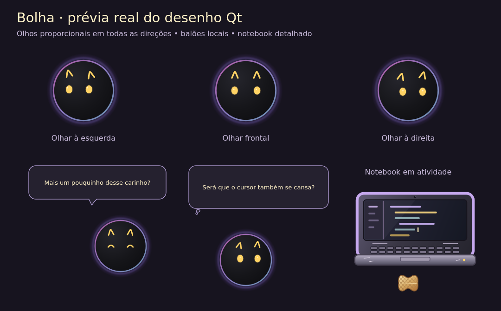
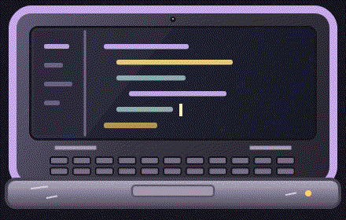

# Bolha 0.4.5: física, olhar e diálogos

Alterações em revisão; o release público continua na versão 0.4.4.

## Resultado

* Bola e amendoim contornam a personagem quando uma parede impede a separação direta. A colisão deixa abertas as passagens reais entre monitores.
* Os dois olhos mantêm tamanho e altura iguais em qualquer direção de olhar. Piscadelas intencionais continuam independentes.
* Fala e pensamento têm silhuetas próprias, transição de opacidade e posição próxima à personagem, limitada à área útil. Há 78 falas locais em 11 categorias; a política do cérebro seleciona o conteúdo e pode preferir silêncio. Histórico recente limita repetições. Desligar travessuras desativa falas espontâneas.
* Notebook redesenhado com materiais, tela, teclas, dobradiças, câmera, trackpad e marcas de uso. Sua atividade visual atualiza somente enquanto está visível e trabalhando.
* O topo visível de janelas de diferentes aplicativos vira superfície. Trechos cobertos por janelas à frente são removidos. A geometria é convertida por monitor e por escala, inclusive em coordenadas negativas. Pequenos deslocamentos verticais mantêm o apoio; fechamento, minimização e grandes deslocamentos soltam o corpo.

A leitura usa somente geometria externa das janelas, sem conteúdo, títulos ou painéis internos. A preferência de leitura de janelas continua obrigatória; quando desligada, não há consulta nativa nem plataformas de aplicativos.

## Assistente de instalação

O assistente valida a pasta ao clicar em **Instalar**. Aceita caminhos ainda inexistentes, explica quando um destino é recusado e pode oferecer uma pasta dedicada quando a escolhida contém arquivos. Uma instalação reconhecida pode ser reinstalada no mesmo destino. Se a Bolha estiver aberta, o assistente informa como fechar pela bandeja e permite repetir ou cancelar.

O [teste gráfico com arquivos descartáveis](https://github.com/kuky13/bolha/actions/runs/43278324061) passou em quatro cenários: pasta nova com subpastas ainda inexistentes, pasta com arquivos preservados, reinstalação no mesmo destino e pasta antiga não reconhecida com alternativa ao lado.

## Prévias reproduzíveis

Gerar a prancha com `python scripts/preview_visual_polish.py DIRETORIO`.
Todas as novas artes, falas, animações e prévias seguem GPL-3.0-or-later.

## Validação automatizada

Em Linux com Qt offscreen, Python 3.11 e PySide6 6.11.3:

* Suíte completa: 637 aprovados, 11 ignorados por dependerem de Windows.
* Após acrescentar a integração de leitura Windows e definir a versão 0.4.5: 17 aprovados nos testes de plataformas, metadados e contrato da cena.
* Testes de colisão cobrem empurrões contínuos por 90 quadros, paredes e cantos, objetos segurados, desconexão, costuras físicas com DPI diferente e ausência de sobreposição dos círculos.
* Testes vetoriais cobrem proporção e alinhamento dos olhos em nove direções e 14 expressões; os testes de imagem existentes cobrem rotação, tamanho, deformação, efeitos e recorte no corpo.
* Testes de balões cobrem seleção sem repetição imediata, estado de brincadeira expirado, privacidade, silêncio, posicionamento negativo e transições.
* Testes de notebook cobrem escalas, máscara, preservação da silhueta e diferença entre atividade e repouso.
* `git diff --check` aprovado.

A [rodada final Windows](https://github.com/kuky13/bolha/actions/runs/43278521936), no commit `096579f`, passou em 649 testes, quatro cenários do assistente gráfico com o instalador completo e dez cenários de instalação, atualização e recuperação. O instalador baixado do artefato conferiu com o manifesto SHA-256.
Validação manual em computador Windows com monitores físicos: não realizada nesta etapa. O runner e o Qt offscreen não comprovam o comportamento visual de todos os aplicativos reais.

## Menos falas e bobinho

A Bolha espera pelo menos 45 segundos entre balões. A primeira fala espontânea pode aparecer depois de cinco minutos, com espera maior se a preferência de travessuras pedir. Passar o cursor pela bola ou pelo amendoim conta como toque mesmo quando o ponteiro cruza o brinquedo inteiro entre dois quadros. Toques rápidos têm força limitada. A Bolha persegue por até dez segundos após o último movimento do brinquedo e devolve com menos força.

A [rodada Windows com esses ajustes](https://github.com/kuky13/bolha/actions/runs/43284227992) validou o commit `9a32b29` com 657 testes, quatro cenários do assistente gráfico e dez de instalação, atualização e recuperação. O instalador entregue conferiu com o manifesto SHA-256.
